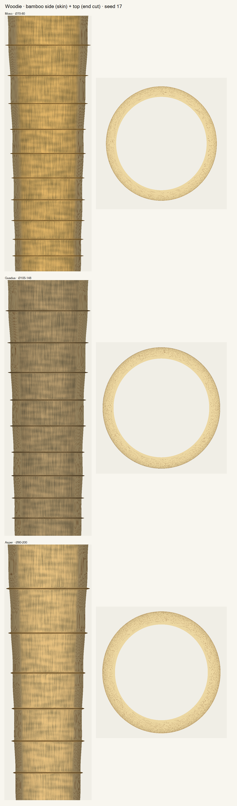
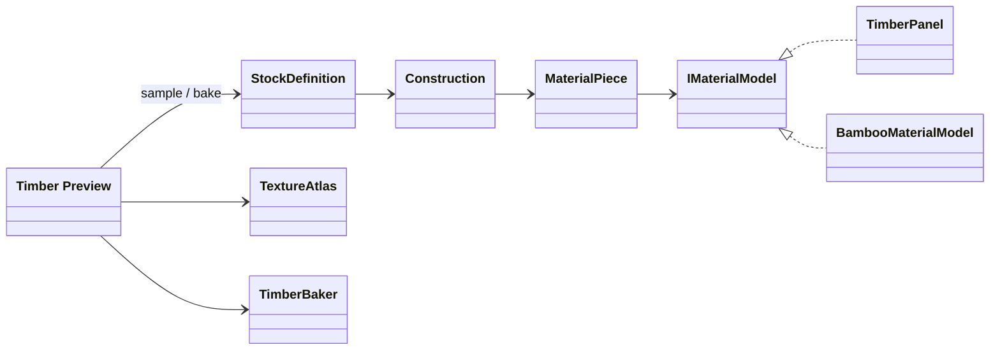
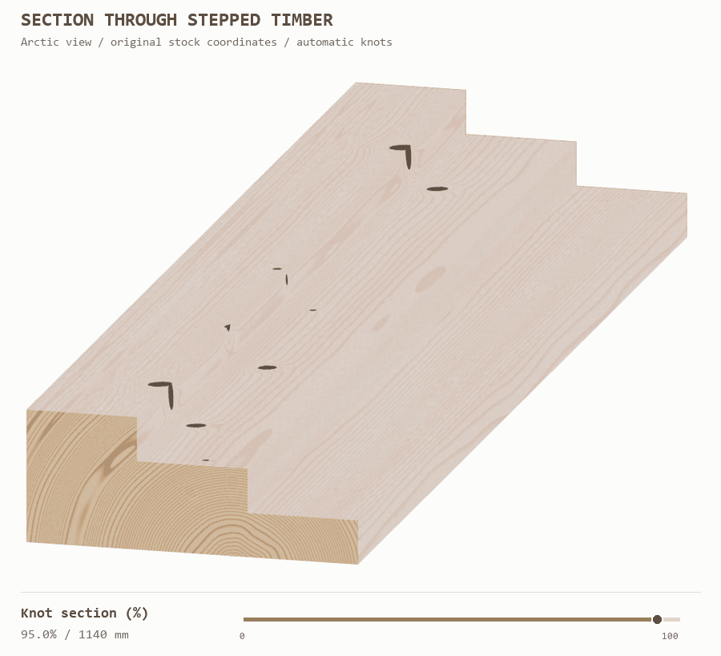

# Woodie

**Woodie** is a Rhino 8.20+ / .NET 8 Grasshopper plugin that shows native geometry as **procedural timber and bamboo**. Connect a mesh, Brep, surface or extrusion. Choose a product. Grain, knots, boards, veneers, hollow culms and engineered bamboo strips come from a **continuous material volume in millimetres** — not a flat image glued to the surface.

**Display → Woodie** · **Timber Material → optional Timber Buildup → Timber Preview**

**0.1.7** keeps Log Stock and Bamboo Stock with a **Larsson-style volumetric bamboo field**: side streaks come from the same outer sheath samples as end-grain flowers (no Fract hatch), with sharper SoftCaps, node fringe and a thin wax skin. Draft/Full preview LOD caps long culm meshes. Sampling stays in the softwood cost class. Mac native display and a fresh interactive Bake-menu session remain unverified. See [validation](docs/validation.md).



*Contact sheet from the checks runner (`--bamboo-render`): side skin and end cut for three construction species. Visual approximation, not a measured species atlas.*

## Why Woodie

| Need | What Woodie does |
| --- | --- |
| Cut through a board and keep the grain | Optional **Stock** locks material coordinates while geometry changes |
| Layered products | CLT, 3S, plywood, LVL, Kerto-Q, custom **Timber Buildup** |
| Natural poles | **Log Stock** and **Bamboo Stock** from a base→tip Line |
| Engineered bamboo | Plain-pressed, side-pressed and layered strip products |
| Take it into Rhino | **Bake** native objects with persistent textures |

Materials are **visual presets**. They are not manufacturing schedules or structural certifications. Softwood appearance is inspired by Larsson et al. (2022). Bamboo uses a separate monocot wall model grounded in published anatomy (bundle density toward the outer wall, Grosser types, RIN–RCIL node spacing). Colours and node paint are appearance adaptations. See [material limitations](docs/material-realism-audit.md) and [natural materials notes](docs/development/natural-materials-research.md).

## How it works

1. Resolve a fibre-aligned frame (or a guide-curve bend) for the part.
2. Measure the part in physical units from Geometry Units and the Rhino document.
3. Build a product layup or a natural/engineered stock definition.
4. Sample the procedural field at each render-mesh triangle in material millimetres.
5. Pack colours into texture atlases for Grasshopper display or Bake.

A cut moves the visible surface through the **same** field. Face grain, end grain and layer edges stay consistent. Open surfaces stay open. Input geometry is never transformed in place.

### Softwood field

Growth rings and knots follow a Larsson-style volumetric construction (independent C# adaptation). Knot influence and Force-flow streamlines are available on engineered timber Previews.

### Bamboo field

Bamboo is **not** annual rings. Internodes are a parenchyma matrix with **vascular bundles** that densify and shrink toward the epidermis (Speichinger / Dixon / Shang / Grosser-guided). Bundles live in wall-polar `(θ, t)` so axial cuts keep the same identities. Nodes share stations between geometry (ridge + diaphragm) and appearance. Texture cache namespace: `woodie-20`.

Engineered bamboo strips map rectangular stock cells into a machined window of a source culm (skin and lining removed). Strip corners stay inside that window.

### Architecture



Typical graph:

```text
Timber Material ──► (optional Timber Buildup) ──► Timber Preview
Timber Layer ─────► Timber Buildup
Material Stock / Log Stock / Bamboo Stock ──► Timber Cut / Timber Preview
Timber Cut ───────► Timber Preview  (Geometry + Stock)
```

## Install

1. Open Rhino → **PackageManager**.
2. Search for **woodie** → Install.
3. Restart Rhino if prompted. Open Grasshopper → **Display → Woodie**.

Use PackageManager for normal installs and updates. Remove any hand-copied `Woodie.gha` from Grasshopper Libraries first.

**Requires Rhino 8.20+** running **.NET 8** (Windows or Mac). Rhino 7 is unsupported. On Windows prefer modern .NET over .NET Framework mode. [McNeel .NET guidance](https://developer.rhino3d.com/en/guides/rhinocommon/moving-to-dotnet-core/).

## Components

| Component | Purpose |
| --- | --- |
| **Timber Material** | Product + Natural/Clean-Pale look. Seed, resolution (mm/pixel), advanced knot/palette inputs. |
| **Timber Layer** / **Timber Buildup** | Physical stacks, schedule, section diagram. Exact thickness or Fit to part. |
| **Timber Cut** | Plane cut with caps. Passes Stock so grain stays fixed. |
| **Timber Preview** | Textured display. Fibre / Base Plane / Guide / Geometry Units. Bake. Engineered timber: Textured, Gradient, Force flow. |
| **Material Stock** | Wrap geometry + settings as a Stock Model. |
| **Log Stock** | Tapered softwood stem from a Line (GUID kept from older Natural Stock). |
| **Bamboo Stock** | Hollow culm from a Line. Species panel: Moso, Guadua, Asper. Diameter Domain overrides the trade Ø range. |

**Timber Material → optional Timber Buildup → Timber Preview**. For cuts, wire Cut’s Geometry and Stock to Preview. [Full input reference](docs/usage.md#complete-component-input-reference).

Engineered products: Solid timber, KVH, Glulam, CLT, Three-layer panel, Plywood, LVL — parallel, Kerto-Q. Plus engineered bamboo lumber (plain / side) and BambooPanel. See [materials](docs/materials.md).

## Example

Open **[Timber-preview.ghx](examples/Timber-preview.ghx)** with **Woodie 0.1.7**:

1. Cut through the stock  
2. Follow a knot (stepped cutaway)  
3. Build your own stack  
4. Product library (eleven geometry cases)  
5. Same log → tower  
6. Natural bamboo culm + vertical section  

Faces use **1 mm/pixel**. Works in millimetre, metre and inch documents. [Example guide](examples/README.md).



## Bake

Right-click **Timber Preview → Bake**. Native types and topology are preserved. Stock is a mapping reference and is not baked. Enable **Save textures** when saving the `.3dm`. [Bake docs](docs/baking.md).

## Accuracy and limits

- Softwood: Larsson-inspired procedural field; not a photo-fitted species model.  
- Bamboo: continuous vascular field with anatomy-guided radial gradients; node colour and epidermis weathering are appearance layers; flower size is preview-scaled for 1 mm texels.  
- Engineered recipes scale or approximate manufacturer tables in places — see the [realism audit](docs/material-realism-audit.md).  
- Mac viewport/Bake interaction: not signed off.

## Development

```powershell
dotnet build tests/Woodie.Checks -c Release
dotnet build src/Woodie/Woodie.csproj -c Release
dotnet run --project tests/Woodie.Checks -c Release --no-build -- --rhino --integration
pwsh ./tools/package.ps1
```

Useful check flags: `--bamboo-render`, `--material-sheet`, `--bamboo-probe`, `--bake-matrix`.

See [development](docs/development.md), [packaging](docs/packaging.md), [validation](docs/validation.md), [contributing](CONTRIBUTING.md), [changelog](CHANGELOG.md). Investigation notes for bamboo live under [docs/development/](docs/development/).

## Research and credits

Softwood grain and knots inspired by **Maria Larsson, Takashi Ijiri, Hironori Yoshida, Johannes A. J. Huber, Magnus Fredriksson, Olof Broman and Takeo Igarashi**, [*Procedural Texturing of Solid Wood with Knots*](https://doi.org/10.1145/3528223.3530081), ACM TOG 41(4), Article 45, SIGGRAPH 2022. [PDF](https://www.ma-la.com/procedural_knots/Procedural_Knots_2022.pdf) · [authors’ repo](https://github.com/marialarsson/procedural_knots).

Woodie is an **independent C# adaptation**, not a port of that codebase. Cut-aware detail also draws on Larsson et al. (2024) and *Mokume* (2025). Noise follows Perlin, [*Improving Noise*](https://doi.org/10.1145/566654.566636), 2002. Bamboo anatomy cues: Grosser & Liese; Dixon & Gibson; Shang; Speichinger et al.; Inoue / Tan (RIN–RCIL); Peng (node reorientation). See [appearance](docs/appearance.md) and [bamboo research notes](docs/development/bamboo-appearance-research.md).

UI patterns follow [McNeel custom attributes](https://developer.rhino3d.com/guides/grasshopper/custom-attributes/) and are informed by [Arup’s GH UI examples](https://github.com/arup-archive/Custom-Grasshopper-UI-Components). Icons: [Phosphor Icons](https://phosphoricons.com/).

Released under the [MIT licence](LICENSE). Icon notices are retained in [THIRD-PARTY-NOTICES.md](THIRD-PARTY-NOTICES.md).
