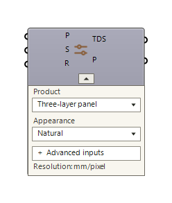

# Woodie

Woodie previews native Rhino geometry as timber in **Rhino and Grasshopper**. Connect a mesh, Brep, surface or extrusion and choose a product to see its grain, knots, board joints and layered construction in the viewport.

Woodie resolves a fibre-aligned frame, measures the part in physical units and samples a procedural wood model over a render mesh. These material coordinates determine face grain, end grain, knots and cross-grain layers. The sampled colours become texture atlases displayed by Grasshopper. A smooth open guide curve maps grain along a bend using arc length; a coherent curved single surface can derive its own bent mapping. Input geometry is unchanged, and open surfaces stay open.

The grain and knot model is inspired by **Maria Larsson et al., [*Procedural Texturing of Solid Wood with Knots*](https://doi.org/10.1145/3528223.3530081), ACM Transactions on Graphics 41(4), Article 45, SIGGRAPH 2022**. Woodie is an independent C# procedural adaptation, not a reproduction of the research implementation or a species-calibrated material model. Full credits and further references are [below](#research-and-credits).

**Timber Material → optional Timber Buildup → Timber Preview** · **Display → Woodie**

The upcoming **0.1.3** candidate adds custom physical layer stacks and capped timber cuts. Connect Timber Cut's **Geometry** and original **Stock** outputs to Preview's **Geometry** and **Stock Geometry** inputs: moving the plane reveals the same material volume rather than generating new knots. The published PackageManager version remains **0.1.2** until the candidate is released.



## Install from Rhino PackageManager

1. Open Rhino and run the **PackageManager** command.
2. Search for **woodie**.
3. Select Woodie and click **Install**.
4. Restart Rhino if prompted, open Grasshopper and find **Display → Woodie**.

**Use Rhino PackageManager for normal installation and updates.** No GitHub checkout, SDK or command-line installation is needed. Remove a previously copied Woodie.gha from Grasshopper Libraries before installing through PackageManager to avoid duplicate components.

**0.1.2** targets **.NET 8** and requires **Rhino 8.20 or later** on Windows or Mac. Rhino 8.20 supplies .NET 8 by default; see [McNeel's runtime guidance](https://developer.rhino3d.com/en/guides/rhinocommon/moving-to-dotnet-core/). On Windows, use modern .NET rather than .NET Framework mode. Rhino 7 is unsupported. Native Mac display and interaction remain unverified; see [validation](docs/validation.md).

## Start with the example

Open the single **[Timber-preview.ghx](examples/Timber-preview.ghx)** definition with the **Woodie 0.1.3 candidate**. It contains four numbered sections, with Scribble headings and groups:

1. **Cut through the stock:** one rectangular piece with position/angle sliders and a textured interior cap.
2. **Follow a knot:** a stepped cutaway with a **Knot section (%)** slider and capped exposed face, revealing the same automatic knot field through its depth.
3. **Build your own stack:** longitudinal/cross layers, a live schedule and a section diagram.
4. **Product library:** all eight products × eleven geometry cases, with a Show toggle on each product card.

The three demonstrations are visible initially; library previews start off to keep the viewport clean. Material controls start collapsed. All geometry is embedded and source units are declared, so the definition works in millimetre, metre and inch Rhino documents. Faces use **1 mm/pixel**. See the [example guide](examples/README.md). For the published 0.1.2 plugin, use its [matching gallery](https://raw.githubusercontent.com/lasaths/Woodie/v0.1.2/examples/Timber-preview.ghx).


Move **Knot section (%)** in section 02 to reproduce this cut. The fixed camera faces the stepped profile; the moving cap samples the original material field, including the knot visible near the end of the sweep. The 186-frame loop runs from 95% to 15% and back, with eased starts/stops and slower travel through the knot crossings.

The product library uses product-appropriate thicknesses and matched flat/bowed centreline lengths. Use a product card's Show toggle to explore its geometry cases.

For older **0.1.1** installations, use its [matching two-board example](https://raw.githubusercontent.com/lasaths/Woodie/v0.1.1/examples/Timber-preview.ghx) in a **millimetre Rhino document**. The new Geometry Units input is available from 0.1.2.

Connect geometry to **Timber Preview → Geometry**, and **Timber Material → Settings** to the preview's **Settings** input. Supply Fibre or Base Plane for explicit orientation and Guide Curve for a controlled bend.

## Custom buildups and cuts (0.1.3)

Use **Timber Layer → Timber Buildup**, with **Timber Material → Timber Buildup → Timber Preview**, to define thicknesses and longitudinal/cross directions. Buildup outputs settings, resolved layers, total thickness, a bottom-to-top schedule and a section diagram. Exact thickness is the default; enable **Fit to part** explicitly to scale the proportions. An open surface uses the stack's total thickness as virtual depth. The original product remains the palette family; custom stacks are labelled **Custom buildup**.

**Timber Cut** cuts and caps closed Breps, solid extrusions and closed meshes. Its **Keep Positive** toggle selects the retained side. Geometry Units applies to the source stock and cutting-plane origin; outputs use Rhino document units, so leave downstream Preview Geometry Units at **Document**. Preview's optional **Stock Geometry** locks its mapping frame, dimensions and layer positions to the uncut stock. The Aligned Box still describes the displayed cut geometry; Frame describes the original material reference. Knots remain continuous within each board or veneer, not across independent layers or glue lines.

See [buildup and cutting controls](docs/usage.md#custom-layers-buildups-and-cuts) for the complete inputs, outputs and examples. No input stock is transformed or cut in place.

## Timber Material

Creates settings for Timber Preview. The on-canvas **Product** and **Appearance** dropdowns default to **CLT / Natural**.

Click the small triangle beneath the icon to hide or reveal the whole control panel without losing wires or values ([collapsed view](docs/images/material-collapsed.png)). **Advanced inputs** exposes additional ports. Advanced ports stay visible if hiding them would remove wires or stored overrides.

| Basic input | What it controls | Default |
| --- | --- | --- |
| Product | Optional product name or identifier; a wire or stored value takes control of the Product dropdown | Dropdown selection |
| Seed | Repeatable random grain, knots and board variation | 0 |
| Resolution | Broad-face texture density in **mm/pixel**; smaller values give finer detail at greater cost | 2 |

| Advanced input | What it controls | Default |
| --- | --- | --- |
| Edge Resolution | Narrow-face texture density, in mm/pixel | 0.5; Kerto-Q 0.25 |
| Knot Density | Knot frequency in knots/metre; 0 removes knots | Product/appearance preset; Clean/Pale 0.25 |
| Ring Spacing | Annual growth-ring spacing, in mm | Product preset |
| Lamella Width | CLT and Three-layer board width, in mm | CLT 150; Three-layer panel 120 |
| Brightness | Colour brightness multiplier | 1 |
| Earlywood A / Earlywood B | Two colours for lighter growth regions | Product/appearance preset |
| Latewood | Darker growth-ring colour | Product/appearance preset |
| Knot | Knot colour | Product/appearance preset |
| Glue | Adhesive/seam colour; Three-layer defaults are light, veneer bond lines darker | Product preset |
| Veneer Thickness | Nominal thickness in mm for Plywood or parallel LVL; layer count is fitted to part depth | Plywood 1.5; parallel LVL 3 |

Settings resolve as **product defaults → appearance defaults → explicit inputs**. **Natural** uses softwood-oriented colours and product-specific knot settings. **Clean/Pale** uses restrained colours and sparse knots. Both preserve the selected construction and use reduced board-to-board tint variation.

| Output | Use |
| --- | --- |
| Settings | Connect to Timber Preview's Settings input; remains output 0 for older definitions |
| Product | Canonical product identifier, such as GL, ThreeS or ParallelLVL |

## Timber Preview

Prepares render meshes, maps timber coordinates and supplies textured Rhino viewport materials. Inputs use Grasshopper **item access**: a single settings value broadcasts over many parts, or matching lists assign different materials, fibres and guides per part.

| Input | Use |
| --- | --- |
| Geometry | Required mesh, Brep, surface or extrusion |
| Settings | Optional Timber Material settings; defaults to CLT when omitted |
| Fibre | Optional world-space vector projected into the base plane; reversing it reverses grain X. Perpendicular vectors are rejected |
| Base Plane | Optional reference plane; X guides fibre orientation and Z defines thickness/layer direction. Inferred when omitted |
| Guide Curve | Optional smooth, open centreline for bent timber; takes precedence over automatic surface mapping. Curve direction sets grain X |
| Show | Enables textured display and texture generation; default true |
| Geometry Units (0.1.2+) | Source coordinate units: Document (default), Millimetres/mm, Centimetres/cm, Metres/m, Inches or Feet. Converts copies of geometry, guide and plane origins to Rhino units |
| Stock Geometry (0.1.3+) | Original uncut geometry in the same source units; locks the material field while Geometry is cut. Omit for normal previews |

| Output | Use |
| --- | --- |
| Meshes | Render meshes with UV coordinates |
| Products | Matching product identifiers for those meshes |
| Aligned Box | One full-geometry bounding box per part in its straight fibre-aligned frame |
| Frame | Matching material frame, anchored at the aligned box minimum |

Woodie supplies the viewport materials; downstream mesh previews do not automatically inherit the textures. The aligned box and frame remain available with bent mapping. Use a guide for curved multi-face or arbitrary mesh geometry when automatic surface mapping is unavailable. Closed guides, cusps and ambiguous mappings are rejected with messages.

Appearance dimensions (texture, board, ring and veneer settings) use **millimetres**. Geometry coordinates default to **Rhino document units**. If coordinates came from a different unit system, declare it with **Geometry Units**; do not manually scale the same input as well. Woodie cannot infer intended units from a shape and does not guess. Resource-limit errors report physical dimensions and units before suggesting appearance changes. Thin surfaces use a virtual depth for appearance and are not thickened. Quick textures refine in the background. See [usage](docs/usage.md) for mapping, virtual depths, quality limits and caching.

## Timber products

| Product | Construction represented |
| --- | --- |
| Solid timber | Continuous solid wood without manufactured joints |
| KVH | Finger-jointed solid timber |
| Glulam | Parallel timber laminations |
| CLT | Seven-layer cross-laminated board preset |
| Three-layer panel (3S) | Longitudinal faces and cross-grain core |
| Plywood | Alternating continuous veneers with an odd layer count |
| LVL — parallel | Longitudinal continuous veneers |
| Kerto-Q | Cross-banded LVL, based on the 45 mm layup |

These are **visual approximations**, not manufactured or structural specifications. Species, coatings, OSB/MDF and NLT/DLT are outside this release. See [material coverage](docs/materials.md) and [known limitations](docs/material-realism-audit.md).

## Build and package

Use the **.NET 8 SDK**, PowerShell 7 and Rhino 8.20+ for native checks.

```powershell
dotnet build tests/Woodie.Checks -c Release
dotnet build src/Woodie/Woodie.csproj -c Release
dotnet tests/Woodie.Checks/bin/Release/net8.0-windows/Woodie.Checks.dll
pwsh ./tools/package.ps1
```

The plugin targets cross-platform `net8.0`; the native runner is Windows-only and needs a licensed Rhino installation. Build the runner before the plugin because its project reference uses a DLL target. Packaging writes a slim Rhino 8.20+ Yak (GHA, short README, manifest/icon, licences and the gallery) and a source ZIP with full documentation under `artifacts/release/`. It does not install or publish anything. See [packaging](docs/packaging.md), [development](docs/development.md), [contributing](CONTRIBUTING.md) and the [changelog](CHANGELOG.md).

## Research and credits

The procedural grain and knots are inspired by **Maria Larsson, Takashi Ijiri, Hironori Yoshida, Johannes A. J. Huber, Magnus Fredriksson, Olof Broman and Takeo Igarashi**, [*Procedural Texturing of Solid Wood with Knots*](https://doi.org/10.1145/3528223.3530081), *ACM Transactions on Graphics* 41(4), Article 45, SIGGRAPH 2022. See the [paper](https://www.ma-la.com/procedural_knots/Procedural_Knots_2022.pdf) and [authors' implementation](https://github.com/marialarsson/procedural_knots).

Woodie is an independent C# procedural adaptation. Cut-aware detail also draws on Larsson et al. (2024) and *Mokume* (2025); [appearance documentation](docs/appearance.md) explains scope, references and evidence. Noise follows Ken Perlin's [*Improving Noise*](https://doi.org/10.1145/566654.566636), SIGGRAPH 2002.

Component controls follow [McNeel's custom attributes guidance](https://developer.rhino3d.com/guides/grasshopper/custom-attributes/) and are informed by [Arup's custom Grasshopper UI examples](https://github.com/arup-archive/Custom-Grasshopper-UI-Components). Neither Arup/Oasys nor the research implementation is required at runtime. Icons are [Phosphor Icons](https://phosphoricons.com/).

Released under the [MIT licence](LICENSE). Upstream copyright and icon notices are retained in [THIRD-PARTY-NOTICES.md](THIRD-PARTY-NOTICES.md).
