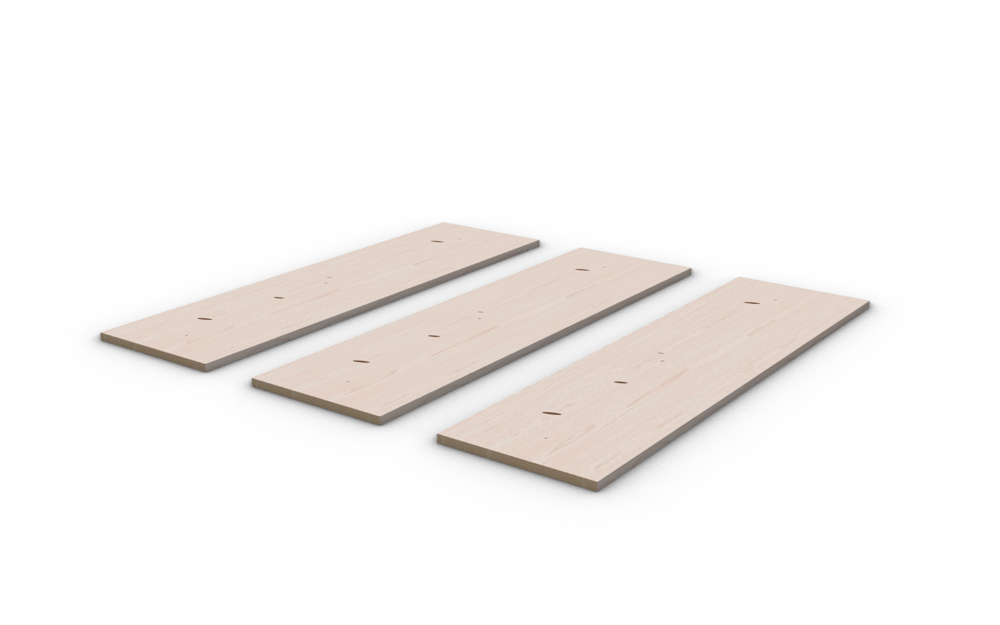
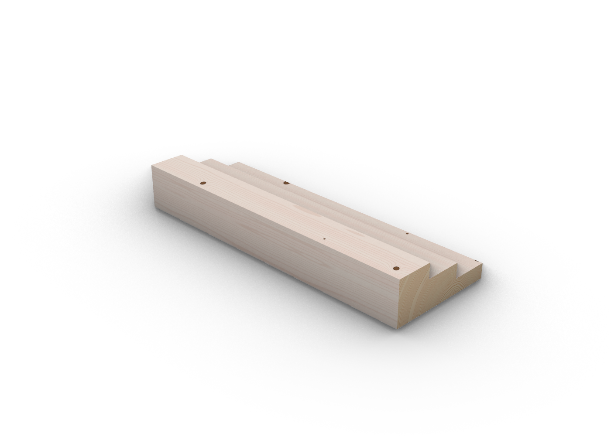

# Native textured baking: feasibility gate

Date: 2026-10-25. Status: **Bake integrated via native UVs; 0.1.3 published; live installed Bake-menu and Mac checks still pending**.

The bake keeps each input as one native Rhino object, with an independent material snapshot that remains valid after saving, reopening and remeshing without Woodie. The original projection-based gate failed; the native-UV route below is what production uses. Opt-in projection probes under `Diagnostics/` stay as a historical failure record and are not part of the ordinary suite.

## Reproduction

Build the checks runner, then the plugin, in Release configuration. Run each explicit diagnostic separately:

```powershell
dotnet tests/Woodie.Checks/bin/Release/net8.0-windows/Woodie.Checks.dll --native-bake-probe
dotnet tests/Woodie.Checks/bin/Release/net8.0-windows/Woodie.Checks.dll --native-chart-probe
dotnet tests/Woodie.Checks/bin/Release/net8.0-windows/Woodie.Checks.dll --native-chart-ray-probe
```

These opt-in feasibility commands deliberately return failure while their acceptance gate is unmet. They are not included in the ordinary check suite. Logs and native 3dm probe files are private build artifacts under `artifacts/`.

The diagnostic attaches Rhino custom mesh mapping to native geometry, assigns a bitmap material, saves without render meshes, reopens the file in a headless Rhino document, and generates a different tessellation. It compares interpolated render-triangle UVs with direct mapping samples at the triangle centres. Errors above two texture pixels are counted. A continuous world-XY UV control uses the same mapping primitive, geometry and tolerance.

## Observed results

| Native fixture | Triangle atlas: failed samples | Continuous face charts: failed samples | Face charts with ray projection: failed samples |
| --- | --- | --- | --- |
| Solid Brep | 1016 / 1092 | 44 / 1092 | 66 / 1092 |
| Extrusion | 1014 / 1092 | 44 / 1092 | 62 / 1092 |
| Trimmed planar face with a hole | 616 / 653 | 0 / 653 | 0 / 653 |
| Bowed single-face Brep | 963 / 1001 | 0 / 1001 | 0 / 1001 |

Native object types and mapping meshes survived reopening. The continuous control had no samples above the two-pixel threshold; its largest measured error was below 0.1 pixel. Triangle-atlas errors reached about 1997 pixels. Continuous charts reduced the problem but retained sharp-edge errors up to about 583 pixels; ray projection did not resolve them.

The face-chart experiments validate coordinates only. Their materials still reference the triangle-atlas diagnostic image; they do not establish visually correct face-chart textures.

## Implication (historical)

Rhino regenerates render triangles independently of Woodie's preview tessellation. UV interpolation can cross unrelated triangle charts. Even continuous per-face charts leave ambiguous mappings at shared sharp boundaries. Merely combining atlas pages into a larger PNG cannot correct this. Production therefore abandoned projection and switched to the native-UV route in the Context7 follow-up below.

## Context7 follow-up: native UVs (2026-10-25)

Context7 library: `/mcneel/rhinocommon-api-docs`. Three targeted documentation queries covered native face materials, extrusion surface parameter mapping, and custom mesh mapping seams. Official RhinoCommon and OpenNURBS references were then checked against the installed Rhino 8.35 APIs.

### Documented mechanisms

- [Surface parameter mapping](https://mcneel.github.io/rhinocommon-api-docs/api/RhinoCommon/html/M_Rhino_Render_TextureMapping_CreateSurfaceParameterMapping.htm) uses native surface parameters instead of projecting UVs from a separate mesh.
- [Seam correction](https://mcneel.github.io/rhinocommon-api-docs/api/RhinoCommon/html/M_Rhino_Geometry_Mesh_SetTextureCoordinates_1.htm) applies to box, sphere and cylinder mappings; it does not promise correction of custom-mesh chart seams.
- [Render mesh texture ranges](https://mcneel.github.io/rhino-cpp-api-docs/api/cpp/class_o_n___mesh_parameters.html) distinguish normalized per-face UVs from Rhino's packed surface layout. The packed layout is the default.
- [Per-face material channels](https://mcneel.github.io/rhinocommon-api-docs/api/RhinoCommon/html/P_Rhino_Geometry_BrepFace_MaterialChannelIndex.htm) allow different textures on a joined Brep. The parent material must be registered and updated in the document; the experiment verifies child references after reopening, including a nonempty material table.
- [Mesh surface parameters](https://mcneel.github.io/rhinocommon-api-docs/api/RhinoCommon/html/M_Rhino_Geometry_Mesh_SetSurfaceParametersFromTextureCoordinates.htm) can preserve UVs for native surface-parameter mapping on meshes.

### Passing probes

```powershell
dotnet tests/Woodie.Checks/bin/Release/net8.0-windows/Woodie.Checks.dll --native-surface-probe
dotnet tests/Woodie.Checks/bin/Release/net8.0-windows/Woodie.Checks.dll --native-packed-probe
```

The probes live under `tests/Woodie.Checks/Diagnostics/`. They are exploratory tools, separate from production baking.

**Joined Brep with face materials:** passes save/reopen, material-reference checks and regeneration of the actual document object's render meshes. All 952 sampled triangle centres reconstruct the expected normalized face UVs. The object remains one closed six-face Brep. Native rendering requires persistent per-object `TextureRange = UnpackedUnscaledNormalized`; the first single-face-only check missed the packed-layout default, which Cassis exposed visually.

**Single-material packed UVs:** paint directly into Rhino's own packed native layout, rather than replacing that layout with the preview's triangle atlas. Across eight Brep, surface and extrusion cases, 42,018 remeshed vertex samples have no errors above two pixels; maximum error is 0.024 pixels measured against a 2048-pixel reference. Cases include trimmed surfaces and bowed native extrusions. Files are saved without render meshes and reopened before regeneration. Extrusions remain extrusions.

**Meshes:** use existing vertex-index seams to form charts; planar components use plane coordinates and curved components use triangulated LSCM internally. This avoids the collapsed UVs observed when invoking LSCM on the whole disconnected closed-box mesh. Only UV data is assigned to the native mesh copy. Closed, open and bowed fixtures retain all vertex positions and face indices (24/6, 4/1 and 528/258 vertices/faces respectively). Native surface mapping reconstructs the UVs to within 0.000001. No visible mesh conversion is performed on Breps or extrusions.

Real Solid timber textures were generated for straight Brep, extrusion and mesh proofs at explicitly selected **2 mm/pixel faces and 1 mm/pixel edges**. Atlas sizes were 2080, 7216 and 2144 pixels square respectively. The native Brep and extrusion each use one material. A finer extrusion setting exceeded the planned 8192-pixel limit and was rejected; production must expose that limit clearly rather than silently lower quality.

### Live Cassis check

The three native textured proofs were inspected in Rhino Rendered mode, including metre-document conversion. The image below was captured after the Grasshopper test document was saved privately and closed. The objects continue to display from Rhino materials, without a Grasshopper preview component.

Left to right: native Brep, native extrusion, native mesh.



### Integration findings

The stability-only packed UV test missed **overlapping bowed-extrusion cap UVs**. Production now checks triangle-chart overlap against physical material coordinates. Native solid extrusions therefore use an enclosing-cube box mapping, divided texture space and closest-point projection. Using a nonuniform box folded distinct material points onto the same UVs and was rejected. The enclosing cube is less space-efficient; the 8192-pixel limit can require a larger mm/pixel setting on extrusions.

Rhino's initial bowed-extrusion render mesh had only 36 triangles despite the angular setting. Sampling that mesh passed a layout-only check but failed after finer regeneration (missing samples and differences above 14 mm). Native sampling now also limits edges to 30 physical mm and disables simple-plane meshing. Across all eleven production fixtures, regenerated triangle centres have no missing UV samples; largest physical interpolation difference is below 0.05 mm. This is an observed bound for these fixtures, not a guarantee for every curvature.

Production meshes preserve their original vertex positions and face indices. Closed welded meshes without suitable existing seams may fail the non-overlap gate; the user must supply seams upstream. Native parts are never converted to document mesh objects as a fallback.

Final PNGs sample the existing stock-aware mapper and procedural field. The eight-product × eleven-case texture matrix passes at explicitly selected 16 mm/pixel face and 8 mm/pixel edge settings. Fine-density overflow remains an explicit failure rather than a silent downgrade. The ordinary integration suite passes 40 checks, including stock-aware units, hidden-preview eligibility, Show invalidation, content reuse, embedded-texture lookup with the external file unavailable, and failed-batch cleanup.

Rhino RDK render materials must be registered and shared directly. Legacy Material table rows are per-object simulations and can multiply even when the render material is shared; tests compare registered render-material identity. Failed commits remove both newly registered RDK materials and any appended legacy simulation rows.

### Remaining acceptance work

Headless bake core/geometry/units/matrix and Cassis document proofs are done. Still verify the installed component's actual Bake menu action, interactive progress/cancellation, Undo/Redo and input changes during preparation on a fresh PackageManager install. Mac loading and display remain unperformed. **0.1.3** was published with these checks outstanding.

### Atlas inset and live knot-section result

A native close view exposed white face-boundary lines even after preserving the legacy texture transform numerically. Final atlas insets are now stored in `TextureMapping.UvwTransform`; the registered RDK bitmap material uses an identity transform. This removes the visible boundary lines on the stepped solid while retaining one joined native Brep. Reopened/remeshed checks include this mapping transform. The baked 70% knot section uses the original Stock, reviewed seed 3, 1 mm/pixel faces and 0.5 mm/pixel edges, with a 2144-pixel atlas.



This image checks document-native geometry/material output. It does not yet verify the newly installed Grasshopper Bake command or interactive cancellation/Undo.
