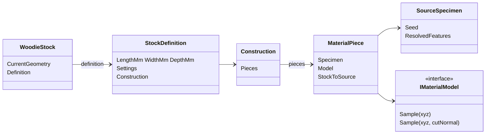

# Shared stock architecture

Woodie stock separates **current geometry** from the **original stock definition**. Cutting changes current geometry; material sampling always returns to the definition’s construction and source specimens. Age, reuse and damage remain future extensions: preserve geometry, source coordinates and cut context, but add no condition classes yet.

## Types

| Type | Responsibility |
|---|---|
| `WoodieStock` | Current geometry plus a reference to its `StockDefinition` |
| `StockDefinition` | Original geometry bounds, physical material coordinates and `Construction` |
| `Construction` | Piece arrangement, joints and adhesive regions |
| `MaterialPiece` | Source region, processing mapping and placement in stock space |
| `SourceSpecimen` | Seed and resolved natural features (rings, nodes, knots, …) |
| `IMaterialModel` | Sample anatomy at a source position and geometric cut normal |

Natural stock contains one whole source piece. Engineered products contain multiple pieces, which may reference different source specimens.

## Sampling

```
stock position → construction piece → source coordinates → anatomy
```

Cut normals travel with the same piece mapping. Background rendering receives only copied managed positions, normals and the immutable material model—no Rhino objects.



## Timber wrap (baseline)

Existing engineered timber products use one identity `MaterialPiece` whose `IMaterialModel` is the calibrated `TimberPanel`. Layer schedules still come from `TimberLayups.Resolve`; atlas packing, refinement, caching and appearance budgets are unchanged. Geometry preparation no longer resolves layers for its own sake—rendering builds a `StockDefinition` from settings and mapped stock dimensions.

## Deferred

- Natural log and bamboo generators (separate commits)
- Bamboo strip machining and laminated products
- Specimen age / reuse / damage models
- Explicit user-authored manufacturing sequences, scrimber, flattened culms

## Threading

Rhino geometry operations stay on the host thread during solution preparation. Background texture jobs use copied triangle coordinates and managed appearance data only.
