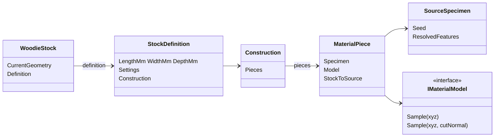

# Shared stock architecture

Woodie stock separates **current geometry** from the **original stock definition**. Cutting changes current geometry; material sampling always returns to the definition’s construction and source specimens. Age, reuse and damage remain future extensions: preserve geometry, source coordinates and cut context, but add no condition classes yet.

## Types

| Type | Responsibility |
|---|---|
| `WoodieStock` | Current geometry plus a reference to its `StockDefinition` |
| `StockDefinition` | Original geometry bounds, physical material coordinates and `Construction` |
| `Construction` | Piece arrangement, joints and adhesive regions |
| `MaterialPiece` | Source region, processing mapping and placement in stock space |
| `SourceSpecimen` | Seed and resolved natural features (rings, nodes, knots, …) |
| `IMaterialModel` | Sample anatomy at a source position and geometric cut normal |

Natural stock contains one whole source piece. Engineered products contain multiple pieces, which may reference different source specimens.

## Sampling

```
stock position → construction piece → source coordinates → anatomy
```

Cut normals travel with the same piece mapping. Background rendering receives only copied managed positions, normals and the immutable material model—no Rhino objects.



## Timber wrap (baseline)

Existing engineered timber products use one identity `MaterialPiece` whose `IMaterialModel` is the calibrated `TimberPanel`. Layer schedules still come from `TimberLayups.Resolve`; atlas packing, refinement, caching and appearance budgets are unchanged. Geometry preparation no longer resolves layers for its own sake—rendering builds a `StockDefinition` from settings and mapped stock dimensions.

## Natural stock

`Natural Stock` (Log / Moso Bamboo) turns a base→tip Line into a native Brep plus a `WoodieStock`. `TimberSettings` carry Diameter, Taper, Bark, Wall, Node Spacing and Variation, so `StockDefinition.FromTimber` dispatches to `StockDefinition.FromNatural` for `Log`/`Bamboo` and Preview, bake and atlas paths need no special case. `FromNatural` builds one `MaterialPiece` whose `SourceSpecimen` holds immutable `NaturalFeatures`, resolved once from the seed with separate geometry and appearance streams; Variation 0 gives nominal taper and nodes only.

- Geometry and appearance read the same resolved node stations (bamboo ridges, diaphragms and node fibre/colour bands). Node and colour behaviour are appearance adaptations, not measured anatomy.
- Hollow stock cuts shell by shell (`Brep.Trim` drops closed void shells) with one annular cap.
- Natural meshes use a 5° grid angle (`TimberSettings.GridAngle`) to stay inside triangle budgets.
- `Product=Log/Bamboo` on a user Brep via Material Stock wraps the stock axis-aligned bounds with cylindrical sampling; Natural Stock is the path that generates geometry.
- `Log`/`Bamboo` are appended to `TimberProduct` but not to `MenuOrder`, so engineered-product tests and hashes are unchanged.

## Engineered bamboo

`BambooLumber` (plain-pressed), `BambooLumberSide` (side-pressed) and `BambooPanel` (layered, 0°/90° strip layers from `TimberLayups`/Buildup) are appended products, outside `MenuOrder`; select them by name on Timber Display Settings. `FromTimber` dispatches to `FromBamboo`, whose `BambooConstruction.Build` makes one `MaterialPiece` per strip. Each piece maps its stock cell rigidly into a generated Moso `SourceSpecimen` (one culm per ring of strips; seeded axial offset and 180° turn per strip), inside a machined wall window that excludes skin and lining, and `Construction` locates pieces through an O(1) grid index. Adhesive lines (`GlueW`/`GlueK`) sit only on faces shared with neighbouring strips.

- Plain-pressed: strip radial = stock Z (stacked through the thickness), tangential = stock Y. Side-pressed: radial = stock Y, tangential = stock Z, so the top shows strip edges. Panels: each layer is a flat strip layer; cross layers put the fibre along stock Y.
- Strip width = Lamella Width (default 20 mm), strip thickness = Veneer Thickness (default 4 mm); strips are planed to tile the stock exactly, so exact-thickness and Fit to part rules are those of `TimberLayups.Resolve`. More than 50 000 strips are rejected.
- Provenance and the Lorenzo laminated-lumber study link are recorded on `BambooConstruction`.

## Deferred

- Scrimber, flattened-culm products, strip end joints
- Branches, roots, stubs and specimen age / reuse / damage models
- Explicit user-authored manufacturing sequences, scrimber, flattened culms

## Threading

Rhino geometry operations stay on the host thread during solution preparation. Background texture jobs use copied triangle coordinates and managed appearance data only.
