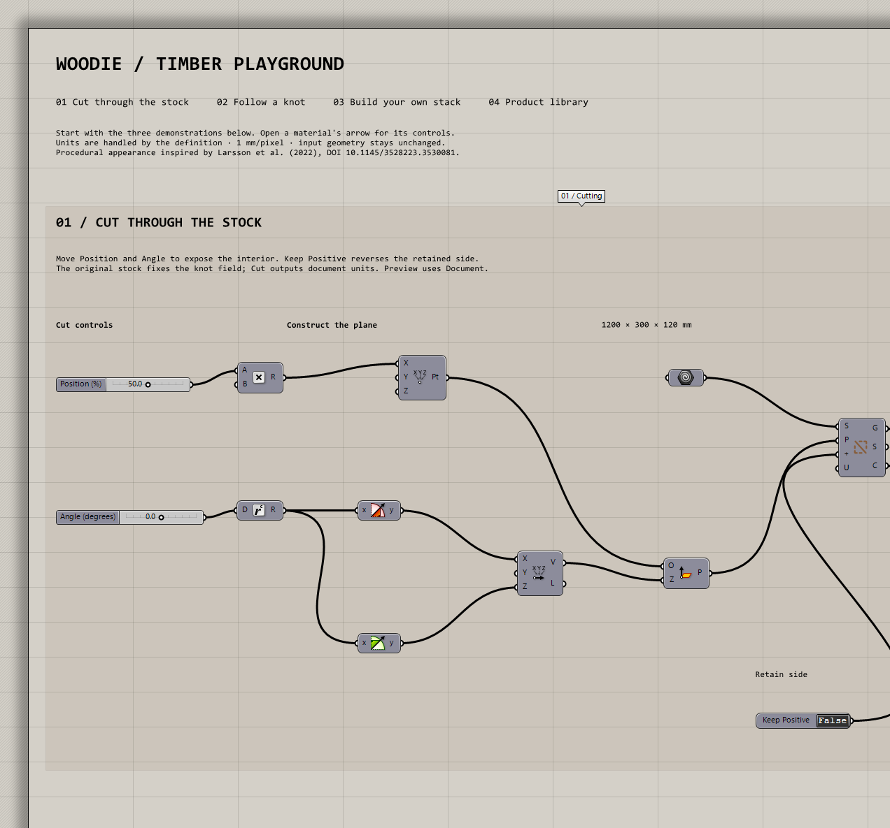
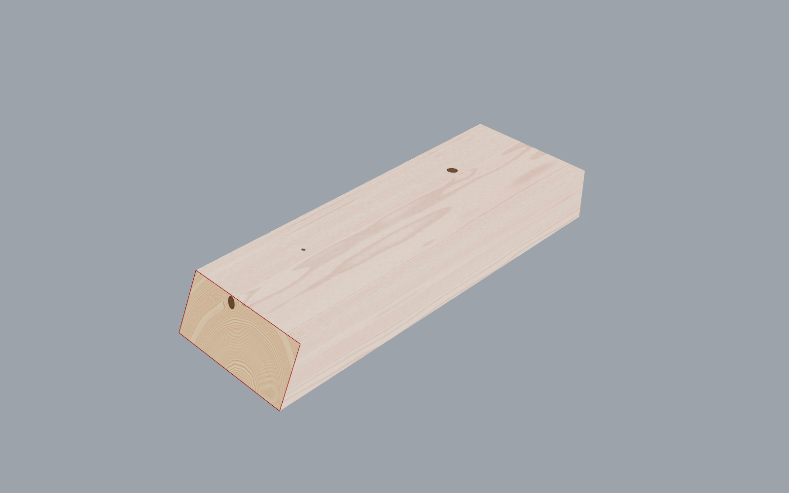
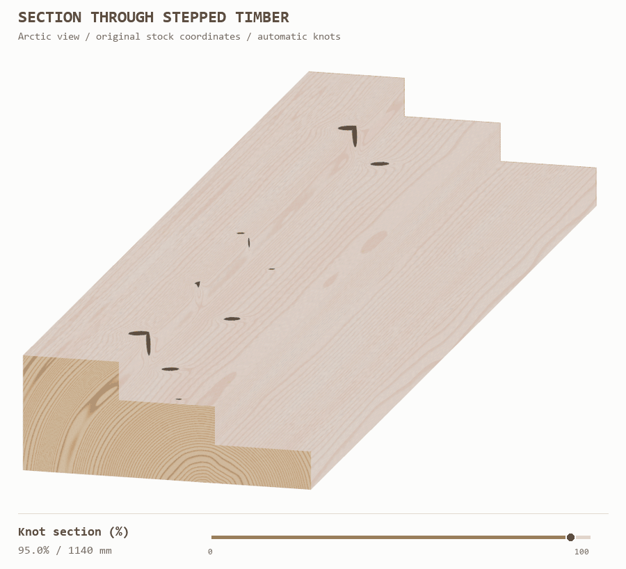
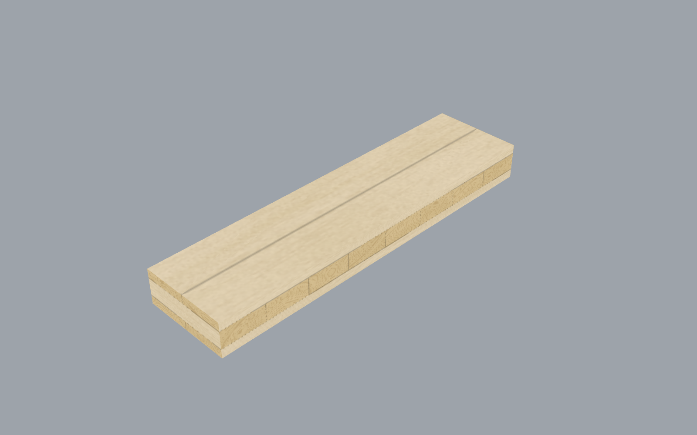

# Using Woodie

## Stock models (0.1.4+)

**Material Stock** wraps a Mesh/Brep/Surface/Extrusion plus Material or Buildup settings into a **Stock Model**. **Natural Stock** builds a tapered Log or hollow Moso bamboo culm from a straight Line (base→tip), with Diameter/Wall/Node Spacing/Bark/Taper/Variation in millimetres and Geometry Units for the line. Both output a Stock Model and ordinary geometry.

Wire **Stock Model → Timber Cut → Stock Model** and **Stock Model → Timber Preview**. In Stock Model mode, Preview rejects simultaneous Geometry, Settings, Fibre, Base Plane, Guide and Stock Geometry overrides. Show still works. Legacy Geometry + Settings + optional Stock Geometry continues on the original ports. Cut appends a Stock Model output list while keeping Geometry, Stock and Section Outlines at their previous indices.

Engineered bamboo products `BambooLumber` (plain-pressed), `BambooLumberSide` and `BambooPanel` are available by name on Timber Display Settings. They are not in the Material product dropdown; strip width/thickness reuse Lamella Width / Veneer Thickness. BambooPanel uses Layer/Buildup with the usual exact-thickness and Fit to part rules. See [stock architecture](development/stock-architecture.md) and [natural-materials research](development/natural-materials-research.md).

## Custom layers, buildups and cuts

These controls require **0.1.3**. They are under **Display → Woodie** and retain item matching. Layer lists are ordered from the stock's minimum thickness coordinate upward.

**Timber Layer** takes Thickness (mm; default 30), Direction (right-click: Longitudinal 0° or Cross 90°), Construction (Solid, Boards or Veneer; default Boards), Board Width (mm; default 150) and End Joints (None, Butt or Finger; default None). Width and joints describe board construction; solid and continuous veneer layers require no end joints. The component outputs an immutable Layer and its description. Native input values, named choices, wires and undo behavior are managed by Grasshopper.

**Timber Buildup** sits between Material and Preview. Its inputs are Settings (optional, default CLT), Layers (optional ordered list), Reference Thickness (optional mm), Fit to part (default false) and Diagram Plane (optional, document coordinates). Without Layers it expands the selected product preset at the reference thickness; the product's representative depth is the default. With Layers, their sum is the default reference thickness. Outputs are Settings, resolved Layers, total Thickness, a readable Schedule and a Section Diagram of 200 mm wide layer rectangles in document units. Hide the component or diagram parameter if the schematic is not needed in the model view.

Exact thicknesses are checked against the original stock depth using document tolerance, with a minimum 0.01 mm physical tolerance. A mismatch reports both values. Enable **Fit to part** to scale the proportions explicitly. The schedule/diagram describe the reference thickness; Preview fits to its actual stock when Fit is enabled. An open surface uses the custom stack sum as virtual display depth and stays open. The selected product remains the appearance/palette family, while Preview labels an override **Custom buildup**. Changing a stack does not specify a manufactured or structural product.

**Timber Cut** takes closed Brep, solid Extrusion or closed Mesh Stock, Cutting Plane, Keep Positive (default false) and optional Geometry Units (default Document). The plane origin uses the stock's source units; axes are directions. Outputs are capped remaining Geometry, the uncut Stock and Section Outlines, all in Rhino document units. A fully outside cut keeps everything or returns an empty result with a remark. Invalid stock or failed splitting/capping produces an error. Input geometry remains unchanged.

Connect **Cut Geometry → Preview Geometry** and **Cut Stock → Preview Stock Geometry**, leaving downstream Geometry Units at **Document**. Preview derives its mapping frame, full dimensions and layer positions from Stock, including any supplied guide. Moving the cut reveals the original field rather than resizing it. Its Aligned Box describes the displayed cut geometry; Frame describes the original material reference. Geometry outside the stock's mapped domain is rejected. Knots remain continuous within a board/veneer and independent across glue lines. A cap is sampled from the material volume; it is not a flat image pasted onto the end.

Open the single [Timber playground](../examples/Timber-preview.ghx). Its numbered Scribble sections cover movable cutting, knot transitions, a custom longitudinal/cross buildup with schedule, and the complete product library. The three demonstrations start visible; use each product card's Show toggle to inspect the library. Material panels start collapsed.

The angled cut exposes an interior face sampled from the original stock:

The stepped cutaway exposes one knot field across several depths. Its **Knot section (%)** slider moves a capped plane along the piece, revealing the same field on a cross-section. Cut Stock remains connected to Preview Stock Geometry, so downstream units are Document:

The custom stack changes grain direction between its outer layers and cross core:

Its [section diagram](images/buildup-diagram.png) shows the 30 / 60 / 30 mm proportions; the Schedule output provides layer directions and physical positions.

## Material and preview controls

Connect **Timber Material → Settings** to **Timber Preview → Settings**. Select **Product** and **Appearance** from the two on-canvas dropdowns. Defaults are **CLT / Natural**. The Product input is an optional override: a wire or stored input value takes control and disables the Product dropdown; its controlling source is shown on the component.

**Hide the whole panel:** click the small triangle beneath the component icon. Click it again to restore Product, Appearance and Advanced controls. This preserves all ports, wires, values and solved outputs, and saves with the definition.

The three basic inputs are **Product**, **Seed**, and **Resolution** (mm/pixel). Click **Advanced inputs** for edge resolution, knots, ring spacing, lamella width, brightness, palette colours, and nominal veneer thickness. Effective settings follow **product defaults → appearance defaults → input overrides**. Product and settings lists use normal item matching. **Settings** remains output 0; output 1 gives the canonical product identifier (e.g. GL, ThreeS, ParallelLVL).

Removing the advanced input ports is blocked while they are connected or hold overrides; hiding the whole panel with the triangle is always allowed. Clear those values and wires first. Legacy definitions keep their original input names, indices, GUIDs, wires and stored settings; the old Presets component still loads but is hidden from the ribbon. Dropdowns and expansion state support undo/redo, duplication and save/reopen. The canvas controls follow the custom attributes pattern documented by [McNeel](https://developer.rhino3d.com/guides/grasshopper/custom-attributes/) and demonstrated by [Arup](https://github.com/arup-archive/Custom-Grasshopper-UI-Components), with no Arup/Oasys runtime dependency.

Connect a Mesh, Brep, Surface, or Extrusion to **Geometry**. Settings are optional; the default is CLT. All inputs use normal Grasshopper item matching, so one settings value broadcasts over multiple objects, or each item can receive its own settings, direction, plane, and guide.

| Input | Meaning |
| --- | --- |
| Settings | Product, seed, palette, knots, rings, lamellas and texture resolution |
| Fibre | World-space vector projected into the base plane; reversing it reverses grain X |
| Base Plane | Reference X direction and layer-stacking Z; inferred when omitted |
| Guide Curve | Smooth open centreline for bent timber; guide direction sets grain X |
| Show | Enables preview and texture generation |
| Geometry Units (0.1.2+) | Source coordinate units; defaults to Document. mm/cm/m/inches/feet are accepted, including full unit names |

Outputs are UV-mapped meshes, matching product labels, and one aligned bounding box and frame per input item. The component supplies viewport materials; connecting the mesh output to another preview does not transfer the materials. Use Timber Preview's own Bake action for native textured objects; see [baking](baking.md).

### Source geometry units (0.1.2+)

Rhino geometry carries coordinates, not a reliable independent unit declaration. By default, Woodie interprets them in the active Rhino document units. An imported or embedded millimetre model opened in a metre document can therefore appear 1,000 times too large.

Set **Geometry Units = Millimetres** when the coordinate values are millimetres, even if Rhino uses metres. Woodie scales copies of the geometry, guide curve and Base Plane origin into document units. Fibre vectors retain their direction. The source geometry, guide and Rhino document units remain unchanged. Outputs and bounds are in document coordinates; texture and construction settings remain in millimetres. Do not scale the input manually as well as selecting the source units.

Use Document for normal geometry modelled in the current Rhino document. Explicit values use ordinary item matching and can broadcast or vary per object. Invalid unit names or unset/nonphysical document units produce actionable errors. Woodie does not automatically guess source units or impose a maximum physical extent.

If the appearance budget is exceeded, the message reports mapped dimensions in millimetres, estimated board segments/knots and the source/document units. Check units first; for a correctly sized object, increase Lamella Width, reduce Knot Density or split the part. The allocation limits remain in place.

### Alignment and bending

For straight parts, Woodie finds the largest planar face/mesh region, or an area-weighted principal frame, then aligns to the longest straight outline direction. A Base Plane overrides the inferred plane; Fibre rotates X within it. Bounds enclose the full geometry in the fibre-aligned frame. The output frame begins at the box minimum.

Guide curves take precedence and use arc length with parallel-transport frames. Set Base Plane to control the initial layer orientation; its Z axis is projected perpendicular to the guide's starting tangent. If these are parallel, the plane's Y axis supplies the initial normal. Curves with kinks, cusps, self-intersections, closed ends, or ambiguous inverse mappings are rejected.

A curved single surface can infer bent grain from its U/V directions. Without overrides, the longer centre isocurve is the longitudinal direction. With overrides, the tangent closest to the resolved fibre is used. Lengths are measured along isocurves in physical units rather than raw UV parameters. This is an appearance mapping, not a fabrication unroll; doubly curved or sheared surfaces may distort. Use a guide for consistent bending across multiple faces or arbitrary meshes. Those inputs otherwise use straight mapping and report a remark.

Thin surfaces and planar open meshes remain thin. They use virtual appearance depths: CLT 200 mm, ThreeS 27 mm, Glulam/KVH/Solid timber 120 mm, Kerto-Q/parallel LVL 45 mm, Plywood 18 mm. No solid thickness is generated. Products are visual presets, not structural specifications.

### Products and quality

| Product | Identifier | Construction |
| --- | --- | --- |
| Solid timber | SolidTimber | Continuous solid wood, no manufactured joints |
| KVH | KVH | Finger-jointed solid structural timber |
| Glulam | GL | Parallel timber lamellas with finger joints |
| CLT | CLT | Cross-laminated boards, representative seven-layer appearance |
| Three-layer panel | ThreeS | Longitudinal faces, cross-grain core |
| Plywood | Plywood | Continuous alternating veneers, odd layer count, nominal 1.5 mm |
| LVL — parallel | ParallelLVL | Continuous longitudinal veneers, nominal 3 mm |
| Kerto-Q | KertoQ | Representative cross-banded LVL with scarf joints |

**Natural** uses softwood-oriented colours with restrained board tint and cut-aware grain detail. **Clean/Pale** uses a restrained palette and 0.25 knots/metre; it preserves layup and lamella width. Generic plywood and parallel LVL fit their veneer count to total physical depth. Veneer Thickness overrides the nominal thickness for those two products only. Plywood always has at least three layers and an odd layer count. These are generic visual constructions, not manufacturer-certified specifications. See [material coverage](materials.md) for references and verification.

Species, coatings, OSB/MDF and NLT/DLT are outside this release.

Resolution values are in **mm/pixel**, independent of document units. Smaller values add detail. Atlas pages are capped at 2048 pixels per side and 16 pages per object; density is reduced when needed. Each object is limited to 200,000 triangles; there is no maximum physical extent.

The renderer pads unused triangle-tile space with edge colours to prevent filtered texture seams. Curved surfaces use finer angular tessellation for a smoother silhouette. The first display uses quick textures and refines in the background. Input changes, hiding, disabling Show, clearing, and removal invalidate old work. Textures are cached in the user's local application-data directory under `Woodie/Textures/woodie-8`. Cache files can be deleted while Rhino is closed; they are recreated as needed. On meshes, curved coordinates are evaluated at vertices and interpolated across triangles; refine coarse input meshes for smooth bending.

See [material limitations](material-realism-audit.md) before using a preset as a reference for a particular manufactured product.

## Complete component input reference

## Timber Material

Creates settings for Timber Preview. The on-canvas **Product** and **Appearance** dropdowns default to **CLT / Natural**.

Click the small triangle beneath the icon to hide or reveal the whole control panel without losing wires or values ([collapsed view](images/material-collapsed.png)). **Advanced inputs** exposes additional ports. Advanced ports stay visible if hiding them would remove wires or stored overrides.

| Basic input | What it controls | Default |
| --- | --- | --- |
| Product | Optional product name or identifier; a wire or stored value takes control of the Product dropdown | Dropdown selection |
| Seed | Repeatable random grain, knots and board variation | 0 |
| Resolution | Broad-face texture density in **mm/pixel**; smaller values give finer detail at greater cost | 2 |

| Advanced input | What it controls | Default |
| --- | --- | --- |
| Edge Resolution | Narrow-face texture density, in mm/pixel | 0.5; Kerto-Q 0.25 |
| Knot Density | Knot frequency in knots/metre; 0 removes knots | Product/appearance preset; Clean/Pale 0.25 |
| Ring Spacing | Annual growth-ring spacing, in mm | Product preset |
| Lamella Width | CLT and Three-layer board width, in mm | CLT 150; Three-layer panel 120 |
| Brightness | Colour brightness multiplier | 1 |
| Earlywood A / Earlywood B | Two colours for lighter growth regions | Product/appearance preset |
| Latewood | Darker growth-ring colour | Product/appearance preset |
| Knot | Knot colour | Product/appearance preset |
| Glue | Adhesive/seam colour; Three-layer defaults are light, veneer bond lines darker | Product preset |
| Veneer Thickness | Nominal thickness in mm for Plywood or parallel LVL; layer count is fitted to part depth | Plywood 1.5; parallel LVL 3 |

Settings resolve as **product defaults → appearance defaults → explicit inputs**. **Natural** uses softwood-oriented colours and product-specific knot settings. **Clean/Pale** uses restrained colours and sparse knots. Both preserve the selected construction and use reduced board-to-board tint variation.

| Output | Use |
| --- | --- |
| Settings | Connect to Timber Preview's Settings input; remains output 0 for older definitions |
| Product | Canonical product identifier, such as GL, ThreeS or ParallelLVL |

## Timber Preview

Prepares render meshes, maps timber coordinates and supplies textured Rhino viewport materials. Inputs use Grasshopper **item access**: a single settings value broadcasts over many parts, or matching lists assign different materials, fibres and guides per part.

| Input | Use |
| --- | --- |
| Geometry | Required mesh, Brep, surface or extrusion |
| Settings | Optional Timber Material settings; defaults to CLT when omitted |
| Fibre | Optional world-space vector projected into the base plane; reversing it reverses grain X. Perpendicular vectors are rejected |
| Base Plane | Optional reference plane; X guides fibre orientation and Z defines thickness/layer direction. Inferred when omitted |
| Guide Curve | Optional smooth, open centreline for bent timber; takes precedence over automatic surface mapping. Curve direction sets grain X |
| Show | Enables textured display and texture generation; default true |
| Geometry Units (0.1.2+) | Source coordinate units: Document (default), Millimetres/mm, Centimetres/cm, Metres/m, Inches or Feet. Converts copies of geometry, guide and plane origins to Rhino units |
| Stock Geometry (0.1.3+) | Original uncut geometry in the same source units; locks the material field while Geometry is cut. Omit for normal previews |

| Output | Use |
| --- | --- |
| Meshes | Render meshes with UV coordinates |
| Products | Matching product identifiers for those meshes |
| Aligned Box | One full-geometry bounding box per part in its straight fibre-aligned frame |
| Frame | Matching material frame, anchored at the aligned box minimum |

Woodie supplies the viewport materials; downstream mesh previews do not automatically inherit the textures. The aligned box and frame remain available with bent mapping. Use a guide for curved multi-face or arbitrary mesh geometry when automatic surface mapping is unavailable. Closed guides, cusps and ambiguous mappings are rejected with messages.

Appearance dimensions (texture, board, ring and veneer settings) use **millimetres**. Geometry coordinates default to **Rhino document units**. If coordinates came from a different unit system, declare it with **Geometry Units**; do not manually scale the same input as well. Woodie cannot infer intended units from a shape and does not guess. Resource-limit errors report physical dimensions and units before suggesting appearance changes. Thin surfaces use a virtual depth for appearance and are not thickened. Quick textures refine in the background. See [usage](usage.md) for mapping, virtual depths, quality limits and caching.
